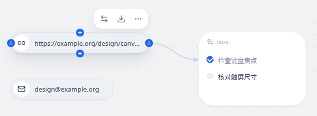
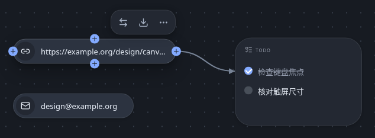

# Yua Canvas 前端 UI 设计规范

本规范用于编辑器、共享预览与离线 HTML 的共同展示元素。尺寸均为 CSS px，采用 `border-box`。工具栏固定在窗口时按屏幕像素测量，卡片及其内部控件按画布 100% 缩放测量。设备像素比只影响栅格化精度。连线描边、命中描边和换接手柄单独按屏幕像素计算。

以下为同一画布在 100% 缩放下的浏览器实拍。长地址正在悬浮，邮箱处于静置状态，连线终点位于第一条 TODO。

| 浅色 | 深色 |
| --- | --- |
|  |  |

## 颜色与表面

| 用途 | 主题变量 | 浅色 | 深色 |
| --- | --- | --- | --- |
| 画布底色 | `--canvas-bg` | `#F1F2F4` | `#171B22` |
| 卡片、菜单内容底色 | `--surface` | `#FFFFFF` | `#232832` |
| 地址胶囊、次级表面 | `--surface-muted` | `#EDF0F4` | `#2C3340` |
| 正文 / 次要文字 | `--ink` / `--muted` | `#334155` / `#64748B` | `#E0E6EF` / `#A7B2C4` |
| 普通边框 | `--border` | `#D5DAE4` | `#454E5E` |
| 选择、键盘焦点 / 激活底色 | `--accent` / `--accent-soft` | `#2563EB` / `#EFF6FF` | `#83AAFF` / `#283956` |
| 连线与箭头 | `--connection-color` | `#D1D5DB` | `#788497` |
| 复制成功的图标 / 底色 | `--success-ink` / `--success-surface` | `#177047` / `#E6F5EB` | `#8FDFB0` / `#234239` |

投影由浮动容器承担，容器内按钮以底色、文字和焦点环反馈。底部工具栏表面混合 61% 的主题表面色，使用 18px 背景模糊。设置和表单弹窗使用实色。系统要求降低透明度时采用实色表面。用户指定的卡片底色与相应的文字颜色一起进入预览和导出。

## 字体、边界与间距

| 对象 | 字号与布局 |
| --- | --- |
| 界面文字 | 根字号 14px，沿用 Inter、系统 UI 字体与系统中文回退。表单及 TODO 正文基准 13px |
| 文本组件 | 默认字号 13px、行高 24px、编辑内边距 12px。用户字号生效时行高取 24px 和字号的 1.5 倍中的较大值，选区内的独立格式保留 |
| 缩放读数 | 12px 字号、16px 行高、字重 500、等宽数字。读数按钮宽 46px，数字变化时相邻按钮位置固定 |
| 对话框标题 | 18px，行高 1.35。连线选择器宽度取 360px 与视口宽减 32px 中较小值，内边距 20px |
| 普通卡片 / 小尺寸图标卡 | 普通内容卡圆角 28px，小尺寸卡高 56px、圆角 16px，类型图标旁显示组件名称，宽度随名称扩展到最多 320px。锁定蒙层沿卡片圆角裁切，选中边框贴合外缘 |
| Markdown 和文本文件预览 | 中尺寸正文宽 410px，上下留白 16px、左右 24px。大尺寸正文宽 820px，上下留白 32px、左右 48px。拖动边框后，「自定义」记录该组件最近的尺寸 |
| 菜单 / 对话框 | 菜单圆角 12px、内边距 8px，菜单项圆角 8px、水平内边距 12px。标准对话框圆角 18px |
| TODO 编辑行 | 输入框高 30px，行高 22px，内边距上下 3px、左右 7px。行内间距和行间距均为 6px，勾选框和删除按钮占固定空间，文字占剩余宽度 |

## 链接与邮箱

外部卡片绘制唯一的 1px 边界。图标容器为 32×32px 正圆，内部图标为 16×16px，左、上、下内边距为 4px，图文间隔 10px，末尾留白 14px。默认高度为 **42px**，即 1 + 4 + 32 + 4 + 1。图标左缘和卡片外缘相距 5px。字号增大时，外高取 `max(32, ceil(最大字号 × 1.5)) + 10`。图标保持居中。

自动粘贴的宽度取文本实测宽度向上取整后加 62px，最大 320px。默认单行省略，完整地址保存在文字和标题属性中。横向滚动模式可查看整条地址。图标容器始终保持正圆，地址文字承担剩余宽度。

图标悬浮采用次级表面色。鼠标右键、键盘 Enter 或空格均可访问“取消链接”。正文支持选中、拖动、双击编辑及修饰键点击打开，键盘可用 Enter 打开。导出的 HTML 沿用图标、尺寸和主题，文字可编辑，图标作为展示元素。

## 画布控件与连线

| 对象 | 桌面 | 触屏与状态 |
| --- | --- | --- |
| 普通操作按钮 | 高 32px，水平内边距 12px，同组间距 8px | 粗指针设备高 44px |
| 卡片悬浮工具栏 | 外框距卡片 8px，边框 1px，内边距 4px，按钮间距 2px。按钮 32×32px、圆角 12px。外框高 42px、圆角 17px | 按钮 36×36px，外框高 46px。触屏可直接操作，编辑内容时隐藏悬浮栏、连接点与尺寸手柄 |
| 创建 / 绘画工具栏 | 常规创建栏 264×51px，图标按钮 37×37px，两栏相距 12px。绘画栏收起宽 51px、展开宽 292px | 粗指针栏高 50px，创建按钮高 44px。390px 宽屏幕按钮宽 44px，320px 宽屏幕压缩至 37.5px，页面两侧各留 12px |
| 画笔输入 | 颜色框 26×26px，色样内缩 3px。粗细滑轨高 5px、滑块直径 15px | 粗指针滑轨输入框高 44px，中心的可见轨道保持 5px |
| 小地图与层级 | 总览区 230×132px，地图 200×132px、圆角 12px。层级栏宽 25px，每项高 24px。普通短线 12×4px，当前层 16×4px，圆角 2px | 窗口宽 ≤700px 时，总览区 164×90px，地图 136×90px。层级多时纵向滚动，悬浮或聚焦显示完整层级名称的单行预览，过长时省略 |
| 组件连接点 | 按钮命中框 24×24px，1px 边框内留 3px，可见圆面直径 16px。常态隐藏，卡片悬浮、内部焦点或连接时显示 | 命中框 28×28px，1px 边框内留 4px，可见圆面直径 18px，常态可见。吸附以固定锚点为准，屏幕距离 56px 内捕获、72px 内维持 |
| 连线与换接 | 普通线宽 2px，选中 3px，透明命中描边 14px。键盘焦点线宽 3.5px、实段 6px、间隔 2px | 换接手柄命中框 24×24 屏幕像素。键盘和指针共用端点合法性和撤销逻辑 |

窗口宽 ≤700px 且使用精细指针时，底栏采用 44px 高的紧凑布局。宽 ≤385px 时缩放工具改为两列，避免遮挡左侧小地图。缩放后的卡片保留画布坐标，工具栏切换和指针悬停只调整控件本身。

## 焦点、选中、反馈

- 选中属于画布数据的当前操作对象。焦点属于接收下一次键盘操作的控件。工具可同时显示激活底色和 2px 键盘焦点环。环向内偏移 3px，在工具栏和菜单边缘也能看全。
- 每张卡片的连接点占一个 Tab 停靠位。方向键在该卡片可见端点间循环，Enter 或空格打开目标选择器。可选目标包含同层其他组件及 TODO 行端点。Esc 取消并返回原控件。连线本身可用 Enter 或空格选中、F2 编辑标签，选中后可在起点或终点手柄上激活换接。
- 组件与 Pin 的右键色板允许连续选择。每次激活立即反映颜色并更新选中项，按 Esc 或点击外部关闭。桌面色块直径 19.2px、间隔 6.4px，触屏直径 28px、间隔为直径的三分之一。
- 编辑器中的删除、方向键与输入法组合输入由编辑器处理。原生滑块保留方向键，表单保留提交。悬浮工具在编辑期间退出布局和键盘顺序。
- iTerm2 成功写入剪贴板后显示对勾 1500ms，同时使用平台消息提示结果。不可用操作使用原生禁用语义。系统开启减少动态效果时，静态状态仍能区分。
- 分享、PNG 和离线 HTML 复用内容几何。离线 HTML 展示静态连线，支持文字、TODO 和视口操作。画布编辑手柄与工具栏属于编辑器。

## 验收

| 场景 | 检查方法 |
| --- | --- |
| 几何 | 在 100% 画布缩放读取 `getBoundingClientRect()`。核对 42px 胶囊、三边 5px 外缘距离、32px 固定图标、46px 缩放读数。放大字号和拉窄卡片后检查图标与省略号 |
| 桌面 / 触屏 | 分别以精细和粗指针打开 1280px、390px、320px 宽视口。切换创建、绘画和缩放，确认控件可点击、输入光标完整、层级名称可达 |
| 键盘 | 用 Tab 进入控件，以方向键选端点，分别测试新建、换接、取消、标签编辑、撤销。检查连线焦点前后命中描边均为 14px |
| 主题与导出 | 在浅色、深色和自定义卡片底色下检查文字、图标和焦点。打开导出的 HTML，核对图文间距、编辑、勾选、右键平移和缩放 |

主题变量见 [theme.css](../src/theme.css)，地址几何见 [noteLinks.ts](../src/noteLinks.ts) 和 [address.css](../src/address.css)，卡片控件见 [card-surfaces.css](../src/card-surfaces.css)，底栏断点见 [bottom-tools.css](../src/bottom-tools.css)。
