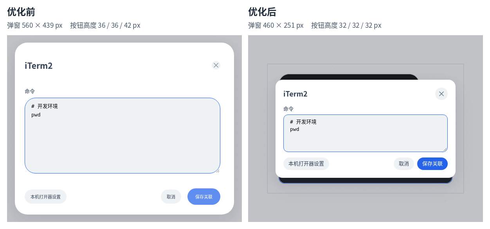

# 按钮尺寸与布局验收

以 `dc3e742` 为修改前版本，在同一块示例画布上分别运行修改前后的应用，打开 iTerm2 关联并输入两行命令。桌面截图取自 1280 × 800 视口，两边裁切相同区域、保持相同比例。下文尺寸均为 CSS 像素。

[修改前完整截图](desktop-before.png) · [修改后完整截图](desktop-after.png)

## 1. 应用关联

| 场景 | 弹窗高度，修改前 → 修改后 | 三个按钮的最终高度 | 验收结果 |
| --- | ---: | ---: | --- |
| 中文桌面，1280 × 800 | 439 → 251 | 32 | 命令框从 194 缩至 96，三项操作同高 |
| 中文平板，768 × 1024 | 439 → 293 | 44 | 单行排列，操作区完整可点 |
| 中文手机，390 × 844 | 429 → 285 | 44 | 单行排列，命令输入字号为 16 |
| 中文小屏，320 × 568 | 429 → 337 | 44 | 设置换行，取消和保存保持相邻 |
| 英文深色，320 × 568 | 415 → 333 | 44 | 长标签完整显示，保存按钮在弹窗内 |
| 中文横屏，844 × 390 | 351 → 293 | 44 | 打开即能操作页脚，无需滚动 |

三个按钮按文字长度决定宽度。用浏览器读取每个按钮的边界，并对中心点做命中检查。在桌面、手机和横屏视口，也输入了 40 行命令并滚动到最后一行。另从画布进入 VS Code 配置、本机打开器，检查长标签、关闭键及底部操作。关联弹窗保留多行输入、滚动、手动调整高度和键盘保存。

[平板](tablet.png) · [手机](phone.png) · [320px 中文](phone-320.png) · [320px 英文深色](phone-en-dark.png) · [横屏修改前](landscape-before.png) · [横屏修改后](landscape-after.png) · [VS Code](vscode.png) · [本机打开器](launcher.png)

## 2. 主画布、设置和帮助

320px 宽时，原有缩放栏与小地图横向重叠约 67px。调整控件排列后，两组控件之间留出约 36px。390px 宽时，创建工具和缩放图标的点按区域为 44 × 44。桌面设置面板从 420px 缩至 333px。进入帮助后，滚动正文时标题和关闭按钮保持可见。

[320px 修改前](canvas-before.png) · [320px 修改后](canvas-after.png) · [绘画工具](paint.png) · [触屏色板](palette.png) · [设置](settings.png) · [帮助](help.png)

## 3. 编辑与设置弹窗

| 实际操作 | 验收结果 | 截图 |
| --- | --- | --- |
| 在文件详情里切换预览和编辑 | 长文可独立滚动，标题和页脚保留在视口内 | [手机文件预览](editor.png) |
| 编辑备注、Mermaid 图表和 Miniature | 保存和取消同高，横屏可访问页脚 | [备注](remark.png) · [Mermaid](mermaid.png) · [Miniature](miniature.png) |
| 从设置打开主密码和云端面板 | 桌面主密码弹窗由 419px 缩至 294px，云端弹窗由 408px 缩至 312px。320px 英文长名称能换行，撤销操作可见 | [主密码](password.png) · [云端](cloud.png) |
| 打开 Agent 配置 | 操作按钮采用同一高度，返回和保存相邻 | [Agent 配置](agent.png) |

## 4. 分享和 3D

320px 中文只读分享页的页头从 158px 缩至 104px。画布现在从页头底边开始。标题换行时也不会遮住画布。操作 3D 视图的外观切换、重置和退出，桌面控件同高 32px，触屏同高 44px。

[分享修改前](share-before.png) · [分享修改后](share-after.png) · [手机 3D](3d.png)

## 5. 浏览器与宿主

- 在 Linux Chromium、Firefox ESR 和 WebKitGTK 中打开应用并复拍 iTerm2。三种浏览器共检查 54 个弹窗状态，逐项核对按钮中心点可命中，面板无横向溢出。手机和平板在 Chromium 中使用设备视口与触摸模拟。Firefox 和 WebKitGTK 使用不同尺寸的桌面窗口。iOS Safari 和 Android 系统键盘的实体设备验收仍待进行。[Chromium](desktop-after.png) · [Firefox](firefox.png) · [WebKitGTK](webkit.png) · [浏览器测量表](measurements.csv) · [下载 54 张完整截图](browser-captures.zip)
- 在生产构建的 `/yua-canvas/` 子路径完成 Service Worker 缓存，断网重载，再长按画布创建并保存关联。600 × 820 触屏视口中的三个按钮均为 44px。[离线 PWA](pwa.png)
- 在官方 DSH 0.2.2-rc.1 宿主安装本次构建的插件，从侧栏进入画布并保存关联。1160 × 1000 插件视口中的三个按钮均为 32px。[DSH 宿主](dsh.png)

截图用于核对界面尺寸和布局。保存、取消、长文滚动、触屏缩放和离线重载另有浏览器交互检查。云端、分享和 Agent 的截图使用测试数据。

## 自动化回归

最终用例集共 343 项。全量执行时已收集的 341 项中，339 项首轮通过，2 项超时后在默认时限内单独复测通过。随后补入的两项窄屏工具栏与色板用例也均通过。Pages 子路径生产构建通过，离线 PWA 回归 11/11 通过，DSH 插件测试 3/3 通过。
